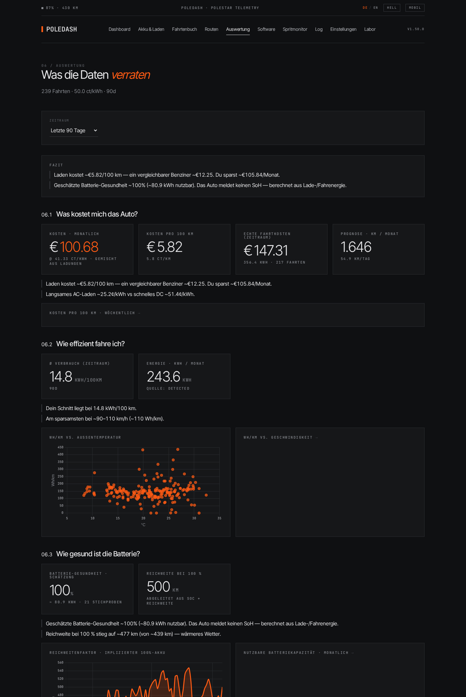

# polestar-dash

Self-hosted web dashboard for your **Polestar 2**. Polls the (unofficial)
Polestar consumer API in the background, stores the history in SQLite, and
serves a single page with SoC, range, charging state, odometer, trips,
sessions, anomalies and service warnings.

Optional: **Email / ntfy.sh / Telegram** push, **MQTT / Home Assistant**,
**Prometheus / Grafana**.

> Unofficial. Not affiliated with Polestar. Uses reverse-engineered endpoints
> via [pypolestar](https://github.com/pypolestar/pypolestar) and may break.

## Screenshots

| Dashboard | History | Insights |
|---|---|---|
|  |  |  |

| Tripbook | | |
|---|---|---|
|  | | |

## Prerequisites

- Linux host with **Docker** + **Docker Compose** (VPS, NAS, Raspberry Pi 4+).
- Polestar account credentials (same email + password as the mobile app).
- ~100 MB disk + ~10 MB/month history.
- Optional: reverse proxy (Caddy/Traefik/nginx) — the app has **no built-in auth**.

## Install

```bash
git clone https://github.com/YOUR/polestar-dash.git
cd polestar-dash
cp .env.example .env
$EDITOR .env       # set POLESTAR_EMAIL + POLESTAR_PASSWORD
docker compose up -d
```

Open <http://localhost:8000>. Container binds to `127.0.0.1:8000`.

> Passwords containing `$` must be wrapped in **single quotes** in `.env`.

Update: `git pull && docker compose up -d --build`. Or add
`--profile ops` for Watchtower auto-updates.

## Pages

| Path | Purpose |
|---|---|
| `/` | Live dashboard with charging hero (animated battery bar, VU gauges for power + voltage), SoC, range, vehicle info |
| `/history` | Time-series + charging sessions |
| `/sessions/{id}` | Per-session charging curve (kW + SoC + V/A) |
| `/tripbook` | Trips from odometer, monthly kWh/100km, iCal feed |
| `/insights` | Wh/km vs speed, weekly €/100 km, idle-drain detector |
| `/software` | Installed software version + since when, version history, and the release-notes changelog scraped from the Polestar manual; emails when a newer version is available |
| `/routes` | Repeated routes aggregated from imported trips |
| `/lab` | Live API field discovery, gRPC proto dump, upstream tracker |
| `/settings` `/errors` `/raw` | Settings, recent errors, raw API dump |
| `/api/*` | JSON for everything above + `/export.csv` + `/tripbook.ics` |
| `/metrics` | Prometheus exposition |

The consumer API does **not** expose live GPS, TPMS or door/window state.

## Configuration

See [`.env.example`](.env.example). Most useful:

| Variable | Default | Notes |
|---|---|---|
| `POLESTAR_EMAIL` / `POLESTAR_PASSWORD` | — | Required |
| `POLESTAR_VINS` | *(auto-discover)* | Comma-separated |
| `POLL_INTERVAL_MIN` | `10` | Idle (floor: 5) |
| `FAST_POLL_INTERVAL_MIN` | `2` | Charging (floor: 1) |
| `SMTP_HOST` | — | SMTP server (e.g. `smtp.gmail.com`) |
| `SMTP_PORT` | `587` | STARTTLS port |
| `SMTP_USERNAME` / `SMTP_PASSWORD` | — | SMTP credentials (Gmail: App Password) |
| `SMTP_FROM` | — | Sender address (defaults to `SMTP_USERNAME`) |
| `SMTP_TO` | — | Recipient address |
| `NTFY_TOPIC` | — | Unguessable string |
| `TELEGRAM_BOT_TOKEN` / `TELEGRAM_CHAT_ID` | — | Bot push |
| `MQTT_HOST` | — | Enables MQTT + HA discovery |
| `BACKUP_KEEP_DAYS` | `14` | Daily SQLite backups |
| `SOFTWARE_MANUAL_URL` | *(Polestar 2 MY2027 manual)* | Page scraped 2×/day for the latest software version |

Electricity prices: set a default `ct/kWh` on `/settings` (defaults to 50);
per-session overrides on the Sessions page get energy-weighted into the
tripbook cost columns.

Trip energy: trips are detected from the odometer plus the car's own
`odometer_event_ts`, so a drive whose odometer reports in one batch still
gets its real duration. The per-trip **kWh/100km** is estimated from the
car's reported average consumption × distance (SoC is only whole-percent,
which is too coarse for short trips). The **kWh (real)** column shows the
exact per-trip energy from an imported Polestar-app journey-log CSV, when
one matches.

Address labels: friendly names (`Home`, `Work`, …) for frequent destinations
shown on `/tripbook` and `/routes`. Multiple addresses can hang off one label
— useful when the same place reports slightly different geocoded strings.
Manage them visually on `/settings` → *Address map* (Leaflet + OSM): every
unique start/end point from imported trips appears as a dot, click to assign.

Software updates: `/software` shows the installed version, since when, the
version history, and the manual's release-notes changelog. Twice a day the
Polestar manual (`SOFTWARE_MANUAL_URL`) is scraped and an **email** is sent
when a version newer than the installed one is listed. Note: the consumer API
returns `software_version: null` for many cars (incl. MY2026), so enter the
version read in-car (*Settings → System → Software update*) once via the form
on the page — auto-detection takes over if the API ever reports it.

## Reverse proxy (Caddy)

```caddyfile
poledash.example.com {
    basic_auth {
        admin $2a$14$...    # caddy hash-password
    }
    reverse_proxy 127.0.0.1:8000
}
```

Reference: [`deploy/Caddyfile`](deploy/Caddyfile).

## Rate limits

Polestar publishes no documented rate limit. The upstream Home Assistant
integration polls every 60 s with no widespread reports of issues; our
defaults (2 min charging / 10 min idle) are conservative. If you ever see
HTTP 429 in `/errors`, stop the container for an hour and restart with
longer intervals.

## How it works

`pypolestar` does OAuth/PKCE login with your account, discovers your VINs,
and queries Polestar's GraphQL + gRPC endpoints every tick. Each poll
writes one typed row (`VehicleSnapshot`) and one full JSON dump
(`RawSnapshot`) to SQLite. Everything else — dashboard, MQTT, Prometheus,
notifications, sessions, tripbook — reads from there.

## Acknowledgements

[pypolestar](https://github.com/pypolestar/pypolestar) (MIT),
ntfy.sh, APScheduler, FastAPI, Chart.js, htmx.

## Licence

MIT — see [`LICENSE`](LICENSE).
