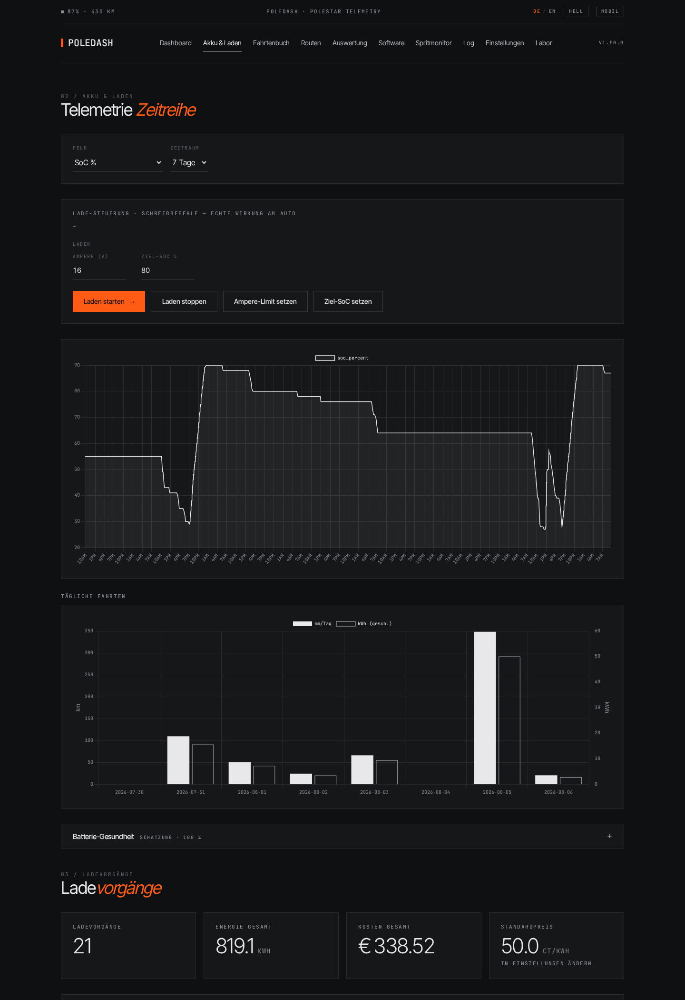

# polestar-dash

Self-hosted web dashboard for your **Polestar 2**. Polls the (unofficial)
Polestar consumer API in the background, stores the history in SQLite, and
serves a single page with SoC, range, charging state, odometer, trips,
sessions, anomalies and service warnings.

Optional: **Email / ntfy.sh / Telegram** push, **MQTT / Home Assistant**,
**Prometheus / Grafana**.

> Unofficial. Not affiliated with Polestar. Uses reverse-engineered endpoints
> via [pypolestar](https://github.com/pypolestar/pypolestar) and may break.

## Screenshots

| Dashboard | History | Insights |
|---|---|---|
|  |  |  |

| Tripbook | | |
|---|---|---|
|  | | |

## Prerequisites

- Linux host with **Docker** + **Docker Compose** (VPS, NAS, Raspberry Pi 4+).
- Polestar account credentials (same email + password as the mobile app).
- ~100 MB disk + ~10 MB/month history.
- Optional: reverse proxy (Caddy/Traefik/nginx) — the app has **no built-in auth**.

## Install

```bash
git clone https://github.com/YOUR/polestar-dash.git
cd polestar-dash
cp .env.example .env
$EDITOR .env       # set POLESTAR_EMAIL + POLESTAR_PASSWORD
docker compose up -d
```

Open <http://localhost:8000>. Container binds to `127.0.0.1:8000`.

> Passwords containing `$` must be wrapped in **single quotes** in `.env`.

Update: `git pull && docker compose up -d --build`. Or add
`--profile ops` for Watchtower auto-updates.

## Pages

| Path | Purpose |
|---|---|
| `/` | Live dashboard with charging hero (animated battery bar, VU gauges for power + voltage), SoC, range, vehicle info, plus a **C3 vehicle-state** section: a top-view of the car with each open door/window/frunk/boot/sunroof highlighted (uses your uploaded vehicle image with an orange open-overlay + status chips, or a built-in green/red SVG diagram as fallback), lock/climate/cabin-air/weather cards, and a satellite mini-map with the live GPS pin + trail. The vehicle-state section reads **live** from the C3 backend so it matches the Test page. A **vehicle control panel** (lock/unlock, windows, climate incl. seat/wheel heating, pre-cleaning, flash/honk, wake) sits beside the diagram — every command shows **verified feedback** (sending → re-reads the car → ✓ verified / ✗ not confirmed) |
| `/history` | **Battery & Charging** — telemetry time-series + charging sessions, plus a **charging control panel** (start/stop, amp limit, target SoC) |
| `/sessions/{id}` | Per-session charging curve (kW + SoC + V/A) |
| `/tripbook` | Trips from odometer in collapsible per-month sections, monthly kWh/100km, iCal feed; imported journey-log table with category/comments + odometer-gap (untracked km) detection |
| `/insights` | Wh/km vs outside temperature, weekly €/100 km, **cabin air & on-car temperature (daily, from C3)**, range factor, idle-drain detector, real trip cost, **CO₂ footprint**, **usable-battery-capacity trend** |
| `/software` | Installed software version + since when, version history, and the release-notes changelog scraped from the Polestar manual; emails when a newer version is available |
| `/routes` | Repeated routes aggregated from imported trips, with a most/least-efficient leaderboard |
| `/test` | Raw C3 debug surface: live GPS map + the full decoded snapshot. The useful bits are now surfaced in the normal UI — extended health (12V battery, washer fluid, per-bulb diagnosis) on the dashboard, live V/A/W + Connector in the charging hero, the car-reported pending update on `/software`, and the control buttons on the dashboard + Battery & Charging — so `/test` is just the raw read-out |
| `/lab` | Live API field discovery, gRPC proto dump, upstream tracker |
| `/settings` `/errors` `/raw` | Settings (address labels + **geofence labels**, a **Trip-flow map**, an **alerts frame** to toggle each notification + set its quiet-hour window, and **automations** — per-rule, opt-in), recent errors, raw API dump. Language (DE/EN) and the light/dark theme toggle live in the topbar |
| `/api/*` | JSON for everything above + `/export.csv` + `/tripbook.ics` |
| `/metrics` | Prometheus exposition |

The pypolestar consumer API does **not** expose live GPS, TPMS or door/window
state. poledash fills that gap with a separate, isolated **C3 (Volvo Cloud
Connectivity)** poll (via `unofficial-polestar-api`) that adds live GPS,
door/window/lock state, climate, cabin PM2.5 and on-car weather — persisted to
`C3Snapshot`, surfaced on the dashboard, fed into trips/routes/charging
(real GPS trails, on-car temperature, air-quality), exported to Prometheus, and
published over MQTT (incl. a Home Assistant `device_tracker`). It also drives a
**rain + windows-open alert** and a one-day-dedup *door/boot left open* /
*unlocked* notification. It also alerts on **health warnings** — 12V battery,
washer/brake/oil/coolant levels, and bulb failures (naming the failed lamp) —
and notifies when the **car itself reports a pending software update** (more
reliable than the manual-scrape path). Disable with `C3_ENABLED=false`.

**Remote control & automations.** The C3 backend also accepts *write* commands,
so poledash can lock/unlock, open/close the windows, run climate + pre-cleaning,
flash/honk, and start/stop charging (incl. amp limit + target SoC) — each issued
from the dashboard or Battery & Charging panels and then **verified** by
re-reading the car's state. On top of that sits a small **automation engine**
(configure on `/settings`): rules that close the windows on their own — when it
starts **raining** at the car, or when they're still open after a chosen
**evening hour** — running either *autonomously* (act, verify, then notify) or
as a **one-tap suggestion** (a push with a confirm link; nothing moves until you
tap). Rules are opt-in and default to suggest. The one-tap link needs
`PUBLIC_BASE_URL` set (otherwise the push degrades to a text hint).

To spare the shared account and the 12V battery, polling **throttles when the
car is at rest** — slower overnight (hard night window) and when the car is
locked & parked during the day. It never slows while charging or driving, and
the dashboard/Test live reads still fetch fresh on demand. Tune or disable via
the `*_IDLE_*` / `*_NIGHT_*` variables below.

## Configuration

See [`.env.example`](.env.example). Most useful:

| Variable | Default | Notes |
|---|---|---|
| `POLESTAR_EMAIL` / `POLESTAR_PASSWORD` | — | Required |
| `POLESTAR_VINS` | *(auto-discover)* | Comma-separated |
| `POLL_INTERVAL_MIN` | `10` | Idle (floor: 5) |
| `FAST_POLL_INTERVAL_MIN` | `2` | Charging (floor: 1) |
| `C3_ENABLED` | `true` | Poll the C3 backend (GPS, doors, climate, air, weather) |
| `C3_POLL_INTERVAL_MIN` | `5` | C3 idle cadence (staggered vs the main poll); kept short so a drive spans at least one poll |
| `C3_FAST_POLL_INTERVAL_MIN` | `5` | C3 cadence while charging |
| `C3_DRIVE_POLL_INTERVAL_MIN` | `2` | C3 cadence while driving (dense GPS trail); set high to disable |
| `ADAPTIVE_IDLE_ENABLED` | `true` | Slow polling when the car is at rest (never while charging/driving) |
| `NIGHT_HOUR_FROM` / `NIGHT_HOUR_TO` | `23` / `5` | Hard-night window (local time), wraps midnight |
| `NIGHT_POLL_INTERVAL_MIN` / `C3_NIGHT_POLL_INTERVAL_MIN` | `30` / `30` | Main / C3 cadence during the night window |
| `IDLE_POLL_INTERVAL_MIN` / `C3_IDLE_POLL_INTERVAL_MIN` | `20` / `15` | Main / C3 cadence when locked & parked during the day |
| `NOTIFY_DOOR_OPEN` / `NOTIFY_UNLOCKED` | `true` | Seed default for the C3 door-open / unlocked alerts (each alert is then toggled + time-windowed on `/settings`) |
| `PUBLIC_BASE_URL` | — | External URL (e.g. `https://poledash.example.com`) for the one-tap confirm links in automation *suggest*-mode pushes; empty ⇒ text hint only |
| `CAR_IMAGE_URL` | — | Optional vehicle image (an upload on `/settings` overrides it) |
| `SMTP_HOST` | — | SMTP server (e.g. `smtp.gmail.com`) |
| `SMTP_PORT` | `587` | STARTTLS port |
| `SMTP_USERNAME` / `SMTP_PASSWORD` | — | SMTP credentials (Gmail: App Password) |
| `SMTP_FROM` | — | Sender address (defaults to `SMTP_USERNAME`) |
| `SMTP_TO` | — | Recipient address |
| `NTFY_TOPIC` | — | Unguessable string |
| `TELEGRAM_BOT_TOKEN` / `TELEGRAM_CHAT_ID` | — | Bot push |
| `MQTT_HOST` | — | Enables MQTT + HA discovery |
| `BACKUP_KEEP_DAYS` | `14` | Daily SQLite backups |
| `SOFTWARE_MANUAL_URL` | *(Polestar 2 MY2027 manual)* | Page scraped 2×/day for the latest software version |

Language: the UI and all notification/alert messages are available in
**German (default)** and **English**, switchable via the **DE/EN toggle in the
topbar** (next to the light/dark theme button).
The choice is stored in the database (app-wide, no restart needed) and also
governs the wording of push/email alerts. The weekly email digest is German.

Electricity prices: set a default `ct/kWh` on `/settings` (defaults to 50);
per-session overrides on the Sessions page get energy-weighted into the
tripbook cost columns.

Session energy & cost: a charge session's kWh is measured by **integrating the
reported charging power** over the session — trapezoidal `∫ charging_power_w dt`
across the persisted snapshots, plus a head/tail correction that bridges the
poll-cadence blind spots at plug-in and unplug (it extends the first/last
observed power across half the gap to the adjacent snapshot, capped at the idle
poll interval). This is the AC-side energy the charge-point operator bills, and
it sidesteps the integer-percent SoC quantization that made short top-ups read
~30 % low (`±1 %` ≈ `±0.8 kWh`). When a session carries no power samples (older
*inferred* charges) it falls back to `ΔSoC × calibrated usable capacity ×
charging-loss factor` — the capacity auto-**calibrated** from imported journey
consumption, the loss factor (`/settings`, default ×1.12 ≈ 12 % AC losses)
grossing net battery energy up to grid draw. Cost is that energy × the effective
price. A CSV import re-calibrating the pack, or changing the loss factor (now
only affecting the SoC fallback), recomputes every complete session so History
stays consistent. The trade-off: very long charges read marginally lower than
the old SoC method, while short charges are dramatically more accurate.

Charging locations: each session has a **Location** field — a dropdown of
known places where picking one fills the **Price (ct/kWh)** field with that
place's saved price, plus a *+ New place…* option for free-text entry that is
remembered. Known places live in a small registry (manage on `/settings` →
*Charging stations*, or add one by name + price there). GPS is optional: when
imported-trip coordinates happen to match a place within ~500 m the session
auto-tags itself, but a place can be name-only. The consumer API exposes no
live GPS, so without that auto-tag you pick the place from the dropdown.

Trip energy: trips are detected from the odometer plus the car's own
`odometer_event_ts`, so a drive whose odometer reports in one batch still
gets its real duration. The per-trip **kWh/100km** prefers the **SoC drop ×
calibrated usable capacity** once a trip is long enough (≥ 10 km and ≥ 2 %
drop) that the whole-percent SoC step (~0.8 kWh) is only a small fraction of
the energy — that's the honest per-trip figure and it varies with cold starts,
climbs, etc. Shorter trips fall back to the car's reported **average
consumption × distance**, since the lifetime average is a slow-moving number
that would otherwise reprint the same efficiency for every drive. The **kWh
(real)** column shows the exact per-trip energy from an imported Polestar-app
journey-log CSV, when one matches.

Imported journey log: the Polestar-app CSV carries more than energy and
addresses. `/tripbook`'s imported-trips table surfaces each trip's **category**
and **comments**, and an **odometer gap** check flags kilometres driven between
logged trips that the app never recorded (a missing-trip / untracked-km signal).

Address labels: friendly names (`Home`, `Work`, …) for frequent destinations
shown on `/tripbook` and `/routes`. Multiple addresses can hang off one label
— useful when the same place reports slightly different geocoded strings.
Manage them visually on `/settings` → *Address map* (Leaflet + OSM): every
unique start/end point from imported trips appears as a dot, click to assign.
Patterns are matched as **case-insensitive substrings**, so keep them specific
— a pattern like `Austria` would match every address and collapse all routes
into one. `/settings` now **warns** when a pattern matches more than five
distinct imported addresses, to catch exactly that. For places where the
geocoded street wanders, prefer a **geofence label** instead: a centre point
plus radius (e.g. *Work* = within 150 m of the office), edited in the *Geofence
labels (radius)* card and resolved after the text patterns.

Trip-flow map: `/settings` (under the address map) draws every imported drive
as an animated arc — coloured by a switchable lens (kWh/100 km · CO₂ · outside
°C · €), thickened by how often you drive it, with your geofence rings overlaid
and a play/scrubber that replays your trips over time with a moving car marker.

Software updates: `/software` shows the installed version, since when, the
version history, and the manual's release-notes changelog. Twice a day the
Polestar manual (`SOFTWARE_MANUAL_URL`) is scraped and an **email** is sent
when a version newer than the installed one is listed. Note: the consumer API
returns `software_version: null` for many cars (incl. MY2026), so enter the
version read in-car (*Settings → System → Software update*) once via the form
on the page — auto-detection takes over if the API ever reports it.

## Reverse proxy (Caddy)

```caddyfile
poledash.example.com {
    basic_auth {
        admin $2a$14$...    # caddy hash-password
    }
    reverse_proxy 127.0.0.1:8000
}
```

Reference: [`deploy/Caddyfile`](deploy/Caddyfile).

## Rate limits

Polestar publishes no documented rate limit. The upstream Home Assistant
integration polls every 60 s with no widespread reports of issues; our
defaults (2 min charging / 10 min idle) are conservative. If you ever see
HTTP 429 in `/errors`, stop the container for an hour and restart with
longer intervals.

## How it works

`pypolestar` does OAuth/PKCE login with your account, discovers your VINs,
and queries Polestar's GraphQL + gRPC endpoints every tick. Each poll
writes one typed row (`VehicleSnapshot`) and one full JSON dump
(`RawSnapshot`) to SQLite. Everything else — dashboard, MQTT, Prometheus,
notifications, sessions, tripbook — reads from there.

## Acknowledgements

[pypolestar](https://github.com/pypolestar/pypolestar) (MIT),
ntfy.sh, APScheduler, FastAPI, Chart.js, htmx.

## Licence

MIT — see [`LICENSE`](LICENSE).
