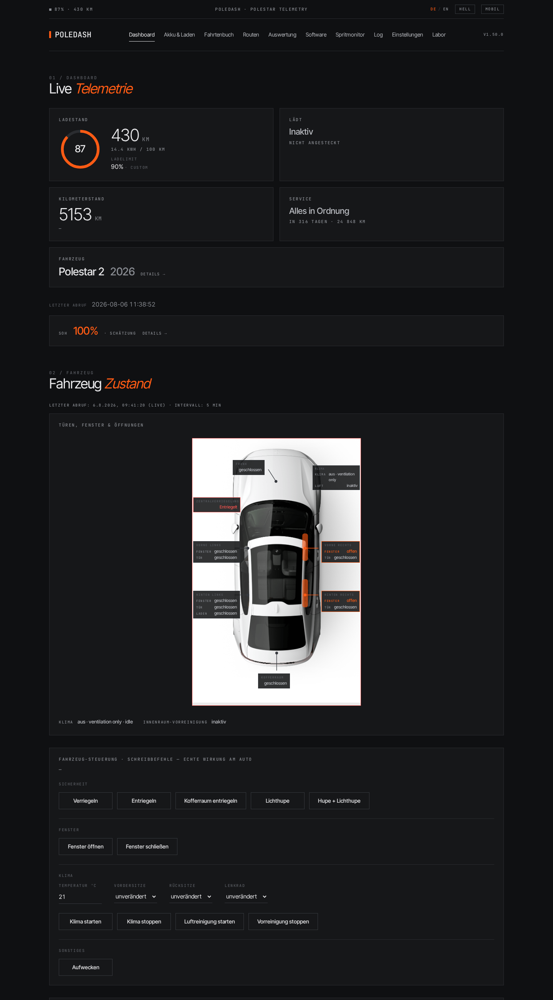
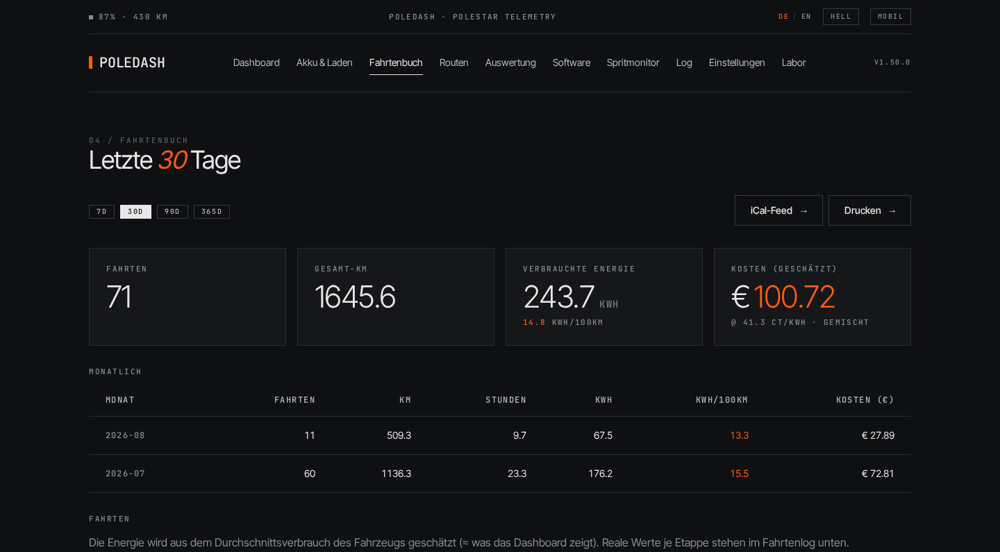
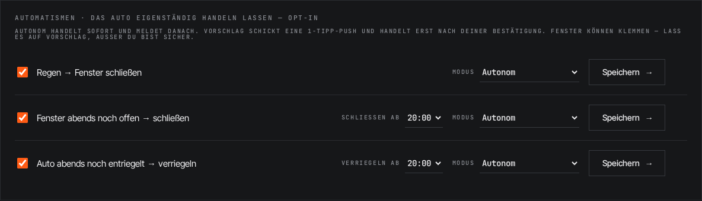

# poledash

**Current version: v1.52.1** — 2026-08-08

| Version | Date | What changed |
|---|---|---|
| **v1.52.1** | 2026-08-08 | Fix: windows/lock-after-time automations could fire while the car was actively being driven (flaky `speed` field read as "parked") — now vetoed by the same robust driving detector used for poll cadence |
| v1.52.0 | 2026-08-08 | Detect the car's own modem/SIM going offline ("no internet"), not just a degraded C3 login — the connection lost/restored alert now covers both |
| v1.51.0 | 2026-08-06 | Per-integration notification toggle (mute WhatsApp/ntfy/Telegram/email/MQTT individually); removed unused files ahead of the public release |
| v1.50.0 | 2026-08-06 | New automation: lock the car if it's still unlocked in the evening |
| v1.49.1 | 2026-08-05 | Fix: phantom charge sessions from downhill recuperation (take 2) |
| v1.49.0 | 2026-08-05 | Cabin climate temp + seat/steering heating from C3; charge-schedule-conflict hint |
| v1.48.0 | 2026-07-22 | WhatsApp push via WAHA sidecar |
| v1.47.2 | 2026-07-13 | Fix: phantom charge sessions from downhill recuperation |

Full history with details: [`CHANGELOG.md`](CHANGELOG.md).

Self-hosted dashboard for your **Polestar 2**. Polls the (unofficial)
Polestar consumer API + a separate C3 (live GPS / doors / climate) backend,
stores everything in SQLite, and serves a single-binary web app: live
telemetry, charging sessions, tripbook, cost/efficiency insights, remote
vehicle control, and a small automation engine — plus optional push
notifications, MQTT/Home Assistant, and Prometheus.

> Unofficial, not affiliated with Polestar. Built on reverse-engineered
> endpoints via [pypolestar](https://github.com/pypolestar/pypolestar) and
> [unofficial-polestar-api](https://github.com/kildahldev/unofficial-polestar-api);
> things may break when Polestar changes their backend.

## Screenshots

| Dashboard | Battery & Charging |
|---|---|
|  |  |

| Insights | Tripbook |
|---|---|
|  |  |

**Automations** (Settings) — opt-in rules that act on the car for you, e.g.
lock up or close the windows if they're still open in the evening:



## Quick start

```bash
git clone https://github.com/YOUR/polestar-dash.git
cd polestar-dash
cp .env.example .env
$EDITOR .env       # set POLESTAR_EMAIL + POLESTAR_PASSWORD
docker compose up -d
```

Open <http://localhost:8000> — the container binds to `127.0.0.1:8000` only;
put a reverse proxy in front to expose it (see [below](#reverse-proxy)).

Update: `git pull && docker compose up -d --build`, or run with
`--profile ops` for [Watchtower](https://containrrr.dev/watchtower/)
auto-updates.

> Passwords containing `$` must be wrapped in **single quotes** in `.env`.

**Requirements:** a Linux host with Docker + Compose (VPS, NAS, Raspberry Pi
4+), your Polestar account credentials (same as the mobile app), ~100 MB disk
+ ~10 MB/month of history. No built-in auth — see [Reverse proxy](#reverse-proxy).

## What's inside

| Page | What it does |
|---|---|
| **/** Dashboard | Live SoC, range, charging state, a **vehicle-state diagram** (doors/windows/frunk/boot/sunroof, lock, climate, cabin air, weather) with live GPS on a mini-map, a **battery-health (SoH)** estimate, and a **remote-control panel** (lock, windows, climate, pre-cleaning, flash/honk, wake) with verified command feedback |
| **/history** Battery & Charging | Telemetry time-series, charging-session list + curves, SoH trend, and a **charging control panel** (start/stop, amp limit, target SoC) |
| **/tripbook** | Trips detected from the odometer, monthly summaries, iCal feed, plus an importer for the official Polestar-app journey-log CSV |
| **/insights** | Answer-first cost & efficiency page — five themed sections (cost, efficiency, battery health, energy waste, environment/patterns) with plain-language auto-generated takeaways, charts as supporting evidence |
| **/routes** | Repeated routes aggregated from imported trips, most/least-efficient leaderboard |
| **/software** | Installed software version + update history (scraped + car-reported) |
| **/spritmonitor** | Export charging sessions to [Spritmonitor.de](https://www.spritmonitor.de/) |
| **/log** | Searchable activity log (polls, sessions, notifications, automations, errors) |
| **/settings** | Prices & loss factor, address/geofence labels + trip-flow map, per-alert toggles + quiet hours, **automations**, language (DE/EN), theme |
| **/lab** | Developer tab — live C3 state, raw API payload, manual control panel, field discovery |
| **/api/\*** | JSON for everything above, plus `/export.csv` and `/tripbook.ics` |
| **/metrics** | Prometheus exposition |

### Live vehicle state (C3)

The consumer API has no live GPS or door/window state. poledash adds a
second, independent poll of the **C3 (Volvo Cloud Connectivity)** backend for
that: live GPS + trail, door/window/lock state, climate, cabin PM2.5, and
on-car weather. It feeds the dashboard diagram, trip/session GPS + on-car
temperature, MQTT (incl. a Home Assistant `device_tracker`), and drives a few
alerts — rain with a window open, door/boot left open, car left unlocked,
health warnings (12V battery, fluids, tyres, lights), and a *connection
lost/restored* pair — covering both the C3 login itself degrading and the
car's own modem/SIM going offline (it keeps serving the last cached state
in that case, so the alert watches the car-reported connectivity reason,
not just missing data). Disable with `C3_ENABLED=false`.

### Remote control & automations

The C3 backend also accepts *write* commands: lock/unlock, open/close
windows, climate + pre-cleaning, flash/honk, start/stop charging (amp limit,
target SoC). Every command is **verified** — poledash re-reads the car's
state afterwards and shows ✓/✗, not just "sent".

On top sits a small **automation engine** (`/settings`): opt-in rules that
act on the car on their own —

- *rain starts while a window is open* → close them,
- *a window is still open past a chosen evening hour* → close them,
- *the car is still unlocked past a chosen evening hour* → lock it.

Each rule runs either **autonomously** (act, verify, then notify) or as a
**one-tap suggestion** (a push with a confirm link — nothing moves until you
tap it). New rules are a trigger function + a registry entry, no UI code
needed. The one-tap link needs `PUBLIC_BASE_URL` set.

### Adaptive polling

Polling **throttles when the car is at rest** — slower overnight and when
locked & parked during the day — and speeds back up instantly on
charge/drive start. It never slows while charging or driving. Tune via the
`*_IDLE_*` / `*_NIGHT_*` variables below.

## Configuration

See [`.env.example`](.env.example) for the full list. Most useful:

| Variable | Default | Notes |
|---|---|---|
| `POLESTAR_EMAIL` / `POLESTAR_PASSWORD` | — | Required |
| `POLESTAR_VINS` | *(auto-discover)* | Comma-separated |
| `POLL_INTERVAL_MIN` / `FAST_POLL_INTERVAL_MIN` | `10` / `2` | Idle / charging cadence (floors: 5 / 1) |
| `C3_ENABLED` | `true` | Poll the C3 backend (GPS, doors, climate, air, weather) |
| `C3_POLL_INTERVAL_MIN` / `C3_FAST_POLL_INTERVAL_MIN` / `C3_DRIVE_POLL_INTERVAL_MIN` | `5` / `5` / `2` | C3 cadence: idle / charging / driving |
| `ADAPTIVE_IDLE_ENABLED` | `true` | Slow polling at rest (never while charging/driving) |
| `NIGHT_HOUR_FROM` / `NIGHT_HOUR_TO` | `23` / `5` | Hard-night window (local time, wraps midnight) |
| `NIGHT_POLL_INTERVAL_MIN` / `C3_NIGHT_POLL_INTERVAL_MIN` | `30` / `30` | Main / C3 cadence during the night window |
| `IDLE_POLL_INTERVAL_MIN` / `C3_IDLE_POLL_INTERVAL_MIN` | `20` / `15` | Main / C3 cadence when locked & parked (day) |
| `NOTIFY_DOOR_OPEN` / `NOTIFY_UNLOCKED` | `true` | Seed default for the door-open / unlocked alerts (each is toggled + time-windowed on `/settings`) |
| `NOTIFY_LOG_ERRORS` | `false` | Notify on ERROR/CRITICAL log lines (deduped, 1/source/hour) |
| `PUBLIC_BASE_URL` | — | External URL for automation one-tap confirm links |
| `CAR_IMAGE_URL` | — | Vehicle photo for the state diagram (or upload on `/settings`) |
| `SMTP_HOST` / `SMTP_PORT` / `SMTP_USERNAME` / `SMTP_PASSWORD` / `SMTP_FROM` / `SMTP_TO` | — | Email notifications |
| `NTFY_TOPIC` | — | [ntfy.sh](https://ntfy.sh) push (unguessable topic string) |
| `TELEGRAM_BOT_TOKEN` / `TELEGRAM_CHAT_ID` | — | Telegram push |
| `WHATSAPP_URL` / `WHATSAPP_API_KEY` / `WHATSAPP_TO` | — | WhatsApp push via the optional WAHA sidecar — `docker compose --profile whatsapp up -d`, see `docker-compose.yml` |
| `MQTT_HOST` | — | Enables MQTT + Home Assistant discovery |
| `BACKUP_KEEP_DAYS` | `14` | Daily SQLite backups |
| `LOG_PERSIST_INTERVAL_MIN` / `LOG_RETENTION_DAYS` | `2` / `90` | Activity-log flush / retention |
| `PETROL_PRICE_EUR_PER_L` / `PETROL_L_PER_100KM` / `PETROL_CO2_G_PER_KM` | `1.75` / `7.0` / `150` | Reference petrol car for the Insights cost/CO₂ comparison |
| `SOFTWARE_MANUAL_URL` | *(Polestar 2 MY2027 manual)* | Scraped 2×/day for the latest software version |

**Language:** UI + all notifications are available in **German (default)**
and **English**, toggled in the topbar (stored app-wide in the DB, no
restart needed).

<details>
<summary><strong>How the numbers are computed</strong> (energy, cost, SoH, trips…)</summary>

**Session energy & cost.** A charge session's kWh comes from integrating the
reported charging power over the session (trapezoidal `∫ charging_power_w
dt`, with a head/tail correction across poll-cadence gaps at plug-in/unplug).
That's the AC-side energy the charge-point bills, and it avoids the
integer-percent SoC rounding that made short top-ups read ~30% low. Sessions
without power samples (older *inferred* charges) fall back to `ΔSoC ×
calibrated usable capacity × loss factor` (loss factor on `/settings`,
default ×1.12). Cost = energy × the effective price (a default `ct/kWh` on
`/settings`, with per-session overrides).

**Charging locations.** Each session has a **Location** field — a dropdown of
known places (managed on `/settings` → *Charging stations*) that fills in the
saved price; GPS auto-tags a session when an imported trip's coordinates
match a place within ~500 m, but a place can also be name-only.

**Trip energy.** Trips are detected from the odometer (+ the car's own event
timestamp for accurate duration). Per-trip kWh/100km prefers **SoC drop ×
calibrated capacity** once a trip is long enough (≥10 km, ≥2% drop) for the
whole-percent SoC step to be a small fraction of the energy; shorter trips
fall back to the car's reported average consumption × distance. An imported
Polestar-app CSV supplies the exact **kWh (real)** column when available,
plus category, comments, and an odometer-gap check for untracked trips.

**Address & geofence labels.** Friendly names (`Home`, `Work`, …) for
frequent destinations, matched as case-insensitive substrings against
geocoded addresses — keep patterns specific, a pattern like `Austria` would
collapse every route into one label (`/settings` warns if a pattern matches
too broadly). For places where the geocoded street wanders, a **geofence
label** (centre point + radius) is more robust.

**Battery health (SoH).** Neither the consumer API nor C3 exposes a SoH
value, so poledash estimates it TeslaMate-style: each charge implies a usable
pack capacity (`energy_kwh ÷ ΔSoC`), each driven month the same from
consumption; the median of recent samples is shown against the nominal 78 kWh
pack, capped at 100%. It's an estimate — AC losses bias it high, so a healthy
pack reads ~100% until real degradation shows.

</details>

## Reverse proxy

The app has **no built-in auth** — put a reverse proxy in front if exposing
it beyond `localhost`:

```caddyfile
poledash.example.com {
    basic_auth {
        admin $2a$14$...    # caddy hash-password
    }
    reverse_proxy 127.0.0.1:8000
}
```

Reference: [`deploy/Caddyfile`](deploy/Caddyfile).

## Rate limits

Polestar publishes no documented rate limit. The official Home Assistant
integration polls every 60 s with no widespread issues; poledash's defaults
(2 min charging / 10 min idle) are conservative. HTTP 429 in `/errors`? Stop
the container for an hour and restart with longer intervals.

## How it works

`pypolestar` does OAuth/PKCE login, discovers your VINs, and queries
Polestar's GraphQL/gRPC endpoints. Each poll writes one typed row
(`VehicleSnapshot`) and one full JSON dump (`RawSnapshot`) to SQLite; a
separate, staggered C3 poll adds `C3Snapshot` / `RawC3Snapshot`. Everything
else — dashboard, MQTT, Prometheus, notifications, sessions, tripbook,
insights — reads from there. APScheduler jobs handle adaptive polling, daily
backup + retention, the software-update scrape, log flushing, and the daily
SoH snapshot.

## Acknowledgements

[pypolestar](https://github.com/pypolestar/pypolestar) (MIT),
[unofficial-polestar-api](https://github.com/kildahldev/unofficial-polestar-api),
ntfy.sh, APScheduler, FastAPI, Chart.js, htmx, Leaflet.

## Licence

MIT — see [`LICENSE`](LICENSE).
